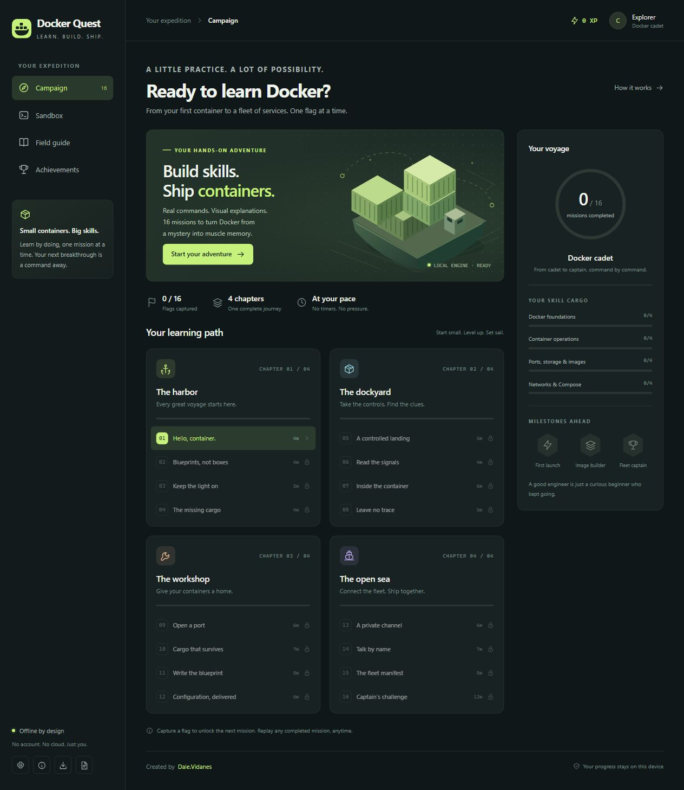

# Docker Quest

Learn Docker one container—and one captured flag—at a time. Docker Quest is a gamified learning adventure with a practice terminal, animated visual explanations, and 16 progressively unlocked missions inspired by flag-based home labs.

## Objective

Help beginners understand how Docker works and build confidence using its commands. Complete practical challenges to learn the relationships between images, containers, ports, persistent storage, networks, and multi-service applications. Capture each mission's flag to earn XP and unlock the next challenge.

| Chapter | Missions | What you learn |
| --- | --- | --- |
| The harbor | 01–04 | Docker foundations, images, running containers, and inspecting state |
| The dockyard | 05–08 | Container lifecycle, logs, exec, filesystem exploration, and cleanup |
| The workshop | 09–12 | Published ports, named volumes, Dockerfiles, builds, and environment variables |
| The open sea | 13–16 | Bridge networks, container DNS, Docker Compose, and a final combined challenge |

## Play

**Only `index.html` is needed to run the game.** Download it and open it in a modern browser. The styles, scripts, and artwork are embedded in that one file. No build step, package installation, account, Docker daemon, or internet connection is required for the downloaded game.

1. Open **Campaign**, choose an unlocked mission, and read its briefing.
2. Enter commands in the practice terminal. Play or step through the diagram to see how the concept works.
3. Complete the objectives, run `claim`, and submit the revealed `DOCK{...}` flag.
4. Earn XP, unlock the next mission, and work toward fleet captain.

Hints are available without an XP penalty. Completed missions can be replayed. Use **Sandbox** to experiment freely, **Field guide** to find commands and concepts, and **Achievements** to view your milestones.

When playing the hosted version, choose **Download offline game** to save a complete HTML copy. Use that downloaded file for disconnected play.

## Progress

Flags, XP, hints, lab state, and command history save automatically in the browser's `localStorage`. Revisit using the same browser, device, and website origin to continue. Progress is stored on the player's device and does not sync through S3 or across devices.

Use **Settings → Export progress / Import progress** to back up or transfer your voyage. Export before changing domains, switching browsers, or clearing browser data. The app displays a notice if browser storage is unavailable.

## Host on S3 or another static site

- Upload **`index.html` only**, with the object Content-Type set to **`text/html`**.
- For S3 static website hosting, set the index document to `index.html`. For CloudFront, set the default root object to `index.html` when hosting at the domain root.
- Use CloudFront with your bucket for HTTPS and a custom domain.

The game also works at a subdirectory or a directly linked HTML object. It has no backend, build process, or external runtime assets. `README.md` and `docs/screenshot.jpg` document the project; neither is needed to host or play it.

## What the terminal models

Docker Quest uses a local teaching simulator rather than a real Docker engine. Commands do not execute on your computer, image pulls do not download images, and simulated HTTP requests do not make network calls.

The simulator tracks images, containers, lifecycle, basic process behavior, published ports, named volumes, environment variables, user-defined networks, basic DNS, and a supplied Compose stack. Builds use the bundled Dockerfile example. It supports a teaching subset of Docker commands and does not emulate arbitrary Linux programs, interactive shells, or arbitrary Dockerfile/Compose editing. Type `help` or open the Field guide to see supported commands.

The goal is to rehearse Docker concepts and commands that transfer to a real Docker installation.

## Creator

Created by **[Dale.Vidanes](https://github.com/edmvidanes)** · GitHub: [@edmvidanes](https://github.com/edmvidanes).
